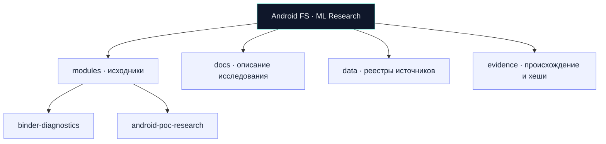

[Главная](../README.md) / [Документация](README.md) / **Архитектура**

# Архитектура репозитория

Монорепозиторий хранит несколько исследовательских модулей, общую документацию и единый план работы. Каждый модуль может развиваться независимо и иметь собственный язык и систему сборки.

Схема показывает организацию материалов. Она не обозначает готовую программную интеграцию между модулями.

| Каталог | Назначение |
|---|---|
| `modules/<module-id>` | Исходники конкретного модуля, описание его статуса и ограничения |
| `modules/catalog.json` | Реестр реально добавленных модулей |
| `modules/_template` | Заготовка для нового модуля; не реализация |
| `shared` | Общие компоненты после появления реального повторного использования |
| `experiments` | Метаданные фактических экспериментов и ссылки на результаты |
| `evidence` | Происхождение и подтверждения заявленных результатов |
| `docs` | Команда, организация работы, отчёт и комплект для сдачи |
| `data` | Реестры исследовательских источников и справочные метки |
| `tools` | Средства проверки происхождения материалов |
| `planning` | План задач и привязка к опубликованным issues |

Новый модуль получает уникальный идентификатор, `module.json`, описание назначения, актуального состояния, окружения и способа проверки. Наличие папки не означает готовности. Проверенные возможности, планы и ограничения указываются отдельно.

В каждой задаче и pull request указывается `module_id`, либо `shared`, если изменение общее. Подтверждения результатов связаны с модулем и ревизией. Вклад участника указывается по реальным изменениям и материалам.

Зарегистрированы `binder-diagnostics`, диагностический прототип Android, и `android-poc-research`, единый исследовательский снимок исходников и существующих отчётов PoC. Второй модуль импортирован 23 октября 2026 года без сборки и запуска; его происхождение и контрольные суммы находятся в `evidence/imports/android-poc-research/`. Общая ML-реализация и обучающие данные этими материалами не подтверждаются.

Общий пакет подготовки данных от 24 октября находится в [data](../data/README.md), [описании подготовки](research/data-preparation.md) и [методике оценки](research/evaluation-methodology.md). Он не зарегистрирован как отдельный исполняемый модуль.

[← Документация](README.md) · [Каталог модулей](../modules/README.md) · [Данные](../data/README.md) · [Подтверждения](../evidence/README.md)
