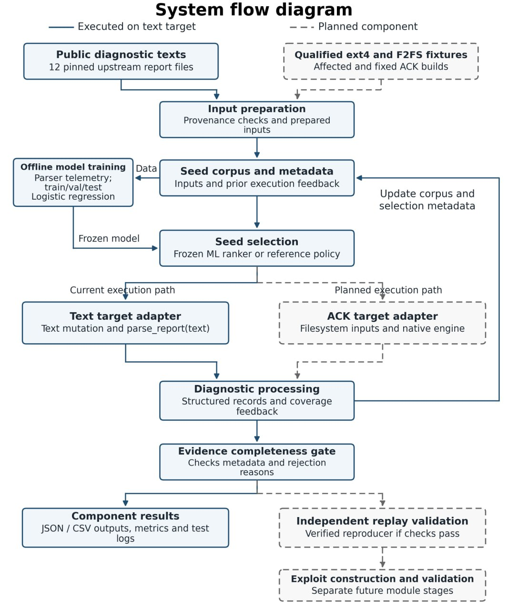

# Методика оценки исследовательских компонентов

Ответственный за оформление методики в репозитории: **Kassymgali Bakytzhan Zhenisuly ([Kerey404](https://github.com/Kerey404))**. Дата: **24 октября 2026 года**. Основа — совместный [Assignment 3](sources/assignment3-tsybus-kassymgali.docx), протокол A3.3. Связанные задачи: [P05 / #5](https://github.com/Nikeka-git/android-fs-ml-research/issues/5), [P06 / #6](https://github.com/Nikeka-git/android-fs-ml-research/issues/6) и [P07 / #7](https://github.com/Nikeka-git/android-fs-ml-research/issues/7).

Методика разделяет проверку происхождения данных, качество текстового диагностического компонента и будущую оценку на Android Common Kernel (ACK). В этом изменении подготовлены документы и проверка публичных источников. Приведённые ниже результаты прототипа взяты из Assignment 3; его программы и журналы не предоставлены в составе этого изменения и повторно не запускались. Эти показатели не являются результатами модуля `binder-diagnostics`.

## Уровни подтверждений

| Уровень | Необходимое основание | Допустимый вывод |
|---|---|---|
| Происхождение текста | Закреплённая ревизия, размер и SHA-256 | Получены именно указанные исходные байты |
| Диагностическая классификация | Текст, разметка, версия парсера и его выход | Компонент возвращает определённую метку на данном тексте |
| Полнота записи | Заполненные поля и согласованные идентификаторы | Запись соответствует структурным требованиям |
| Воспроизведение дефекта | Подлинные журналы независимых запусков и согласованные контрольные проверки | Наблюдение воспроизводимо в указанном окружении |

Хеши не подтверждают правильность разметки. Полный набор метаданных не удостоверяет факт выполнения. Классификация текста, рост покрытия и воспроизведение дефекта по отдельности не подтверждают эксплуатацию уязвимости. На [предоставленной схеме](assets/system-flow.png) текстовый путь отмечен сплошными линиями, будущий ACK-путь — пунктирными; это описание состояния из отчёта.

## Проверка данных

Входом служит [реестр источников](../../data/diagnostic-texts/manifest.json). Считать долю совпавших хешей как число файлов с одновременно верными размером и SHA-256, делённое на число запрошенных файлов. Отдельно сообщать недоступные URL, повторные ID, одинаковые хеши и отсутствующие обязательные поля. Если источник недоступен, проверка не считается успешной. Замена исходных байтов требует новой версии реестра.

Текущая проверка этого изменения: получены 12/12 файлов, суммарно 46 570 байт; сохранены их SHA-256. Это проверка происхождения входов, без запуска описанных в отчёте программ.

## Оценка диагностического парсера

Исследовательский вопрос: насколько структурный разбор диагностического контекста согласуется со справочной разметкой по сравнению с поиском ключевых слов на одних и тех же текстах?

| Показатель | Расчёт | Требуемые данные |
|---|---|---|
| Точное совпадение | Число выходов, равных справочной метке, / число всех текстов оценки | ID, метка, выход обоих методов; отсутствие ответа считается несовпадением |
| Матрица ошибок | Количество пар «справочная метка → выход» | Классы ext4, F2FS, none; ambiguous и отсутствие ответа показывать отдельными выходами |
| Precision класса | TP / (TP + FP) | Матрица ошибок; при нулевом знаменателе — `null` с причиной |
| Recall класса | TP / (TP + FN) | Матрица ошибок; при отсутствии класса — `null` с причиной |
| F1 класса | 2TP / (2TP + FP + FN) | Матрица ошибок; правило неопределённого значения сохраняется |
| Полнота доказательств | Число структурно полных записей / число всех записей | Поля записи и причины отказа, отдельно от качества классификации |

Сохранять все выходы и ошибки, версии сравниваемых методов и исходный знаменатель. Не исключать ошибочные ответы после просмотра результата. Для macro-F1 явно указывать набор классов и не скрывать отсутствующий класс усреднением. На корпусе из 12 текстов обязательно показывать абсолютные числа; одна запись меняет долю совпадений на 8,33 процентного пункта.

В Assignment 3 заявлены 7/12 совпадений у ключевого поиска и 12/12 у структурного парсера, 43 программных теста и отклонение всех 12 текстов проверкой полноты доказательств. В отчёте тексты использовались при разработке правил, поэтому 12/12 не является независимой точностью. Эти числа перенесены как сведения документа и в этом изменении не воспроизведены. Дальнейшая проверка требует исходников `practical`, аннотаций, сохранённых выходов и отдельного корпуса, не использованного при разработке.

## Оценка текстового ML-прототипа

Задача, описанная в Assignment 3, — предсказание прироста покрытия Python-парсера по доступным до выбора входа признакам. Проверять этот вспомогательный результат отдельно от классификации файловой системы и результатов ядра.

Базовый метод для качества модели — постоянный score и доля положительного класса; основной показатель — average precision (AP), дополнительно precision, recall и F1 при заранее заданном пороге. AP вычислять по сохранённым меткам и score стандартным ранжированием: сумма precision на приростах recall. Правило обработки одинаковых score фиксировать до сравнения. При отсутствии положительных или отрицательных наблюдений явно отмечать невозможность содержательного сравнения.

Для замкнутого текстового цикла сравнивать политики при одинаковых исходных текстах, операторах преобразования, правилах допуска в корпус и количестве вызовов. Сохранять парные результаты каждого повтора и отрицательные случаи. Модель и предобработка фиксируются до теста. Признаки должны отражать только уже известную историю; информация о будущих потомках или справочная метка недопустимы. Разделение производных текстов выполняется по исходному файлу согласно [правилам подготовки данных](data-preparation.md).

В отчёте заявлены AP 0,394929 при доле положительного класса 0,261719 и 10 парных текстовых испытаний по 240 вызовов на политику: среднее покрытие 79,9 строки у сравнения и 81,2 у ML. Сохранён отрицательный случай с seed 90219: 79 против 78 строк. Это документальные сведения о текстовом прототипе. Исходные score, разбиение и журналы в этом изменении отсутствуют; доверительные интервалы и повторные результаты по этим числам не восстанавливаются. Локальная политика сравнения не является native-политикой syzkaller.

## План оценки на ACK

Это выдержка из будущего исследования Assignment 3, а не протокол выполненного эксперимента. Целевая популяция — допустимые, публичные, уже исправленные случаи ext4 и F2FS с подтверждённым происхождением и пригодными контрольными конфигурациями. В отчёте предусмотрены 20 тестовых случаев, по 10 на файловую систему, и пять парных повторов для каждой политики; отдельно планируются обучающие, валидационные и пилотные линии происхождения. Наличие такого набора и готового стенда пока не подтверждено.

Единица наблюдения — сессия «политика × случай × повтор», единица независимого статистического вывода — отдельный случай дефекта. Связанные линии происхождения не пересекают части данных. Политики сравниваются при одинаковых ресурсах, исходном состоянии, настройках и бюджете; порядок внутри пары рандомизируется. Предусмотренный в отчёте бюджет — 1 800 секунд на сессию с учётом онлайн-издержек, затраты на обучение учитываются отдельно. Протокол проверки воспроизводимости и пригодность стенда должны быть зафиксированы до тестирования.

| Показатель | Расчёт | Условия интерпретации |
|---|---|---|
| Разность долей воспроизведения | Для случая d: среднее Y(ML,d,r) − среднее Y(reference,d,r) по одним и тем же валидным парным повторам | Y определяется только подтверждёнными наблюдениями по заранее принятому протоколу; отсутствие инфраструктурных данных не равно нулевому результату |
| Общий эффект | Половина среднего эффекта ext4 + половина среднего эффекта F2FS | Сохраняются равные веса файловых систем и отдельных случаев |
| Время до подтверждённого результата | Время обнаружения позже подтверждённого результата; для валидной неуспешной сессии — полный бюджет | Сравнивать время с одинаковым ограничением, сохраняя неуспешные сессии |
| Издержки | Время выбора, число исполнений, обучение и проверка — отдельными величинами | Не скрывать стоимость модели за разным вычислительным бюджетом |

Для основного эффекта в Assignment 3 предусмотрен 95-процентный интервал по 20 000 стратифицированных bootstrap-выборок целых случаев с сохранением парных повторов. 200 планируемых сессий нельзя трактовать как 200 независимых дефектов. Если интервал включает ноль, результат остаётся неопределённым; это не доказательство эквивалентности. По каждой файловой системе публикуются эффекты случаев, числители, валидные знаменатели и пропуски. При малом числе независимых случаев устойчивость интервала ограничена.

Инфраструктурно неполные пары отмечать отдельно; валидный отрицательный результат сохранять. Для пропусков показывать оценку по доступным парам и границы при крайних допустимых исходах с теми же весами случаев и файловых систем. В Assignment 3 допускается одна замена инфраструктурно невалидной пары; нельзя повторять валидные отрицательные запуски до получения успеха.

## Запись и принятие результатов

Будущая запись запуска должна содержать `run_id`, `module_id`, ревизию кода, версию данных, контекст/ID случая, парный ID и номер повтора, метод, хеш модели при наличии, конфигурацию и ресурсы, RNG seed, время начала и конца с часовым поясом, бюджет и фактические затраты, исходы и причины неполноты, ссылки и SHA-256 доступных журналов. Формат ID: `YYYYMMDDTHHMMSSZ-module-id-short-id`; это шаблон, а не существующий запуск.

Перед выводом проверять происхождение данных, отсутствие пересечения групп, сопоставимость пар, полноту исходов, корректность знаменателей и независимость проверки. Для спорных диагностических меток предусмотреть независимый просмотр двумя участниками с сохранением решения; проведённое взаимное ревью сейчас не заявляется.

Для `binder-diagnostics` этот документ задаёт общие правила фиксации данных. Его симуляционные/JVM-тесты и сохранённые lint-отчёты учитываются отдельно: доля успешных тестов характеризует программные проверки конкретного снимка, а не качество ML или воспроизведение дефектов ext4/F2FS. Принимать P05/P06 целиком можно после согласования конкретного вопроса, стенда, наблюдений и базы сравнения именно для этого модуля. Указанные задачи этим изменением автоматически не закрываются.

## Что выполнено и что остаётся

Выполнено: оформлены происхождение и реестр 12 текстовых источников, воспроизводимая проверка их байтов, правила разметки и разделения, словарь показателей, правила сравнения и ограничения выводов. Совместный документ сохранён с исходным авторством. Подготовка этого пакета и его описание в репозитории — текущий вклад Kerey404; разработка всех компонентов совместного отчёта единолично ему не приписывается.

Остаётся получить программы и выходы текстового прототипа, проверить заявленные числа, независимо просмотреть разметку и закрепить фактическое разбиение данных. Для ACK отдельно требуются подходящие случаи, подтверждённый стенд, согласованный протокол и реальные измерения. Новое обучение модели, Android-сборки, испытания ядра и оценка эксплуатации в этом изменении не выполнялись.
